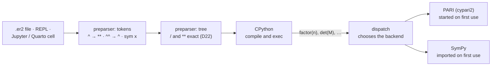

# ER2 in two pages: an overview for contributors

What happens to an ER2 program, which module does what, and where a change goes. The reasons
behind each design choice, and every decision D1–D24, are in
[ARCHITECTURE.md](../ARCHITECTURE.md); the language itself is specified in
[LANGUAGE.md](LANGUAGE.md).

## The pipeline

1. **Syntax first, and only for `.er2` sources.** `er2.preparser.preparse` works on Python's
   tokens, never on the text with regular expressions, so strings and comments are never
   touched and line numbers are kept. It turns `^` into `**`, `^^` into `^`, `sym x` into a
   symbol assignment, accepts `5r`, and fixes the text that `f"{a^2=}"` echoes. Then
   `compile_er2` makes `/` and `**` exact with one pass over the syntax tree (D22), the only
   place where the tokens are not enough. What CPython receives is ordinary Python.
2. **The prelude.** `er2.prelude.namespace` gives the program its starting names: `factor`,
   `phi`, `Matrix`, `GF`, `Mod`, `pari`, … SymPy's names are added only when the program uses
   them, so a number-only program never imports SymPy.
3. **Dispatch.** Every public mathematical function is defined in `er2.dispatch`, which holds
   one table: for each name, a list of `(predicate, implementation)` pairs tried in order. The
   first predicate that accepts the arguments picks the backend. Nothing else in ER2 decides
   which engine computes what.
4. **Backends.** `er2.backends.pari_backend` converts arguments with `to_pari`, calls cypari2
   and converts the result with `from_pari`; `er2.backends.sympy_backend` does the same with
   SymPy. Conversions happen only there, and the user never receives a raw PARI object.
5. **Values and output.** Results are ER2 values (`int`, `Rational`, `Mod`, finite field
   elements, number fields, SymPy expressions and matrices) printed as mathematics by
   `er2.printing` (`x^2 + 1`, `2^3 * 3^2 * 5`); every type has a LaTeX form.

## Where each thing lives

| Module | Role |
| --- | --- |
| `er2/preparser.py` | tokens → Python; `exact_tree` and `compile_er2` (D22) |
| `er2/session.py` | running a file, the REPL, the IPython extension, error messages without ER2's frames |
| `er2/kernel.py` | the `er2` Jupyter kernel |
| `er2/importer.py` | `import module` of `.er2` files |
| `er2/prelude.py` | the names a program starts with |
| `er2/dispatch.py` | the public functions and the backend table |
| `er2/backends/pari_backend.py` | PARI: conversions, the generated `pari.<name>` functions, `start()` (D24) |
| `er2/backends/pari_closures.py` | PARI functions that take a GP expression, called with Python functions |
| `er2/backends/sympy_backend.py` | SymPy: the symbolic implementations |
| `er2/runtime/` | ER2's own types: `numbers` (`Rational`, `exact_div`, `exact_pow`), `modular` (`Mod`), `finite_field`, `number_field`, `factorization`, `qfb`, `dirichlet` |
| `er2/printing.py` | `x^2` output and `latex()` |
| `er2/_lazy.py` | importing SymPy only when needed |
| `er2/oeis.py` | the OEIS, through the optional `oeis-tools` |
| `er2/data/pari_functions.csv` | the table of PARI functions and their ER2 names (edited by hand) |

## Where a change goes

- **A new PARI function** in the prelude or in `pari.`: one row in `er2/data/pari_functions.csv`,
  then `uv run python tools/sync_pari_functions.py` to regenerate `docs/PARI_FUNCTIONS.md`.
- **A function both backends can compute**: an entry in the table of `er2/dispatch.py`, PARI's
  case first, SymPy's as the fallback, and a test that compares the two on random input.
- **A new public name**: a golden LaTeX sample in `tests/test_latex_coverage.py` and its name in
  `PRELUDE_NAMES` of `tests/test_stability.py`, which is the public API.
- **A new type**: plain Python data inside (no PARI object outlives the call that made it), a
  `latex()` form and `_repr_latex_`.
- **Syntax**: only with the maintainer's agreement, in the §3 table of `docs/LANGUAGE.md`, and as a
  token transformation.
- **A speed change**: measured before and after with `make bench-compare`, then
  `make bench-record NOTE="…"` ([PERFORMANCE_ROADMAP.md](PERFORMANCE_ROADMAP.md)).

## Rules that hold everywhere

- Python compatibility: `.py` files and installed libraries are never changed, and inside an
  `.er2` file Python code differs only as the §3 table of `docs/LANGUAGE.md` says
  (`tests/compat/`).
- Never `import sympy` at module level in `er2/`; use `er2._lazy`. Never call PARI at import time;
  `pari_backend.start()` runs on first use.
- Everything must work in Jupyter and Quarto as well as in `er2 file.er2`.
- PEP 8, line length 79, NumPy docstrings: `uv run ruff format && uv run ruff check`.
- `make check` (lint and tests) before every commit; [CONTRIBUTING.md](../CONTRIBUTING.md) has the
  full checklist.
