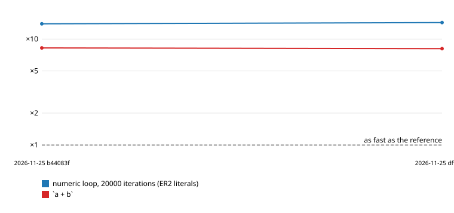

# ER2 performance history

Generated by `uv run python benchmarks/history.py` from the runs in `benchmarks/history/` (`make bench-record` adds one); do not edit by hand.

Each graph shows, run after run, how long ER2 takes compared with its reference (Python, `fractions`, SymPy or PARI through cypari2): below the dashed line ER2 is faster.  The goal is ER2 faster than Python and not much slower than PARI/GP.  Ratios are compared, not times, so runs on the same machine are comparable and the noise of a single run shows as small wiggles.

Runs: 2026-11-25 b44083f (main, baseline, before the improvements); 2026-11-25 dff4757 (main, rational + - * / fast path (c64f3f8)); 2026-11-26 4c333a4 (perf/plain-int, D22: plain int, exact / and ** (perf/plain-int)); 2026-11-26 a1fd279 (main, factor mod p once per call; faster start).

## Startup

| Benchmark | 2026-11-25 b44083f | 2026-11-26 a1fd279 | Change |
|---|---|---|---|
| `er2` startup, number theory only · vs Python | ×6.32 | ×4.03 | ×0.64 |
| `er2` startup, with symbols (loads SymPy) · vs Python | ×21.16 | ×23.17 | ×1.10 |

## Dispatch overhead (§2.1)

| Benchmark | 2026-11-25 b44083f | 2026-11-26 a1fd279 | Change |
|---|---|---|---|
| choose a backend: phi(n), an integer · vs the whole call | ×0.06 | ×0.06 | ×1.08 |
| choose a backend: det, 10x10 over Z · vs the whole call | ×0.01 | ×0.01 | ×0.91 |
| choose a backend: det, 10x10 with a symbol · vs the whole call | ×0.00 | ×0.00 | ×1.02 |
| choose a backend: factor, a polynomial over Q · vs the whole call | ×0.11 | ×0.11 | ×0.94 |

## Integer arithmetic (D2)

| Benchmark | 2026-11-25 b44083f | 2026-11-26 a1fd279 | Change |
|---|---|---|---|
| numeric loop, 20000 iterations (ER2 literals) · vs Python `int` | ×13.93 | ×0.99 | ×0.07 |
| `a + b` · vs `int` `a + b` | ×8.25 | ×8.01 | ×0.97 |

## Exact rationals and large integers

| Benchmark | 2026-11-25 b44083f | 2026-11-26 a1fd279 | Change |
|---|---|---|---|
| `a + b`, rationals · vs `fractions.Fraction` | ×2.80 | ×1.57 | ×0.56 |
| `a * b / (a - b)`, rationals · vs `fractions.Fraction` | ×2.66 | ×1.51 | ×0.57 |
| `3^20000 * 3^20000`, large integers · vs `int` | ×1.01 | ×0.96 | ×0.95 |

## Number theory

| Benchmark | 2026-11-25 b44083f | 2026-11-26 a1fd279 | Change |
|---|---|---|---|
| phi(n), n ≈ 1.2e8 · vs cypari2 | ×1.78 | ×1.70 | ×0.96 |
| phi(n), n ≈ 1.2e8 · vs SymPy | ×0.06 | ×0.05 | ×0.88 |
| sigma(n), n ≈ 1.2e8 · vs cypari2 | ×1.77 | ×1.59 | ×0.90 |
| sigma(n), n ≈ 1.2e8 · vs SymPy | ×0.06 | ×0.05 | ×0.84 |
| isprime(2^127 - 1), proven · vs cypari2 | ×1.02 | ×1.00 | ×0.99 |
| ispseudoprime (BPSW), Mersenne primes · vs cypari2 | ×1.15 | ×1.19 | ×1.04 |
| ispseudoprime (BPSW), Mersenne primes · vs SymPy | ×0.32 | ×0.31 | ×0.96 |
| factor(n), n ≈ 1e18 semiprime · vs cypari2 | ×1.08 | ×0.98 | ×0.90 |
| factor(n), n ≈ 1e18 semiprime · vs SymPy | ×0.02 | ×0.02 | ×0.94 |

## Polynomial factorization

| Benchmark | 2026-11-25 b44083f | 2026-11-26 a1fd279 | Change |
|---|---|---|---|
| factor, degree 4 · vs SymPy `factor` | ×0.47 | ×0.68 | ×1.44 |
| factor, degree 9 · vs SymPy `factor` | ×0.33 | ×0.31 | ×0.93 |
| factor, degree 22 · vs SymPy `factor` | ×0.16 | ×0.15 | ×0.98 |
| factor, degree 60 · vs SymPy `factor` | ×0.04 | ×0.04 | ×1.02 |

## Polynomials over F_p (M5)

| Benchmark | 2026-11-25 b44083f | 2026-11-26 a1fd279 | Change |
|---|---|---|---|
| factor mod 7, degree 12 · vs cypari2 | ×48.88 | ×21.17 | ×0.43 |
| factor mod 7, degree 12 · vs SymPy | ×0.37 | ×0.15 | ×0.42 |
| factor mod 7, degree 48 · vs cypari2 | ×4.95 | ×3.32 | ×0.67 |
| factor mod 7, degree 48 · vs SymPy | ×0.16 | ×0.10 | ×0.64 |

## Linear algebra (M5)

| Benchmark | 2026-11-25 b44083f | 2026-11-26 a1fd279 | Change |
|---|---|---|---|
| det, 10x10 over Z · vs cypari2 | ×8.36 | ×8.20 | ×0.98 |
| det, 10x10 over Z · vs SymPy | ×0.02 | ×0.02 | ×0.89 |
| kernel, 10x10 over Z · vs cypari2 | ×16.33 | ×15.66 | ×0.96 |
| kernel, 10x10 over Z · vs SymPy | ×0.41 | ×0.39 | ×0.97 |
| hermite_form, 10x10 over Z · vs cypari2 | ×7.97 | ×9.42 | ×1.18 |
| hermite_form, 10x10 over Z · vs SymPy | ×0.74 | ×0.81 | ×1.09 |
| smith_form, 10x10 over Z · vs cypari2 | ×4.70 | ×4.36 | ×0.93 |
| smith_form, 10x10 over Z · vs SymPy | ×0.34 | ×0.22 | ×0.66 |
| det, 20x20 over Z · vs cypari2 | ×3.52 | ×3.37 | ×0.96 |
| det, 20x20 over Z · vs SymPy | ×0.01 | ×0.02 | ×1.18 |
| kernel, 20x20 over Z · vs cypari2 | ×3.64 | ×2.61 | ×0.72 |
| kernel, 20x20 over Z · vs SymPy | ×0.30 | ×0.24 | ×0.78 |
| hermite_form, 20x20 over Z · vs cypari2 | ×4.23 | ×3.46 | ×0.82 |
| hermite_form, 20x20 over Z · vs SymPy | ×0.34 | ×0.27 | ×0.79 |
| smith_form, 20x20 over Z · vs cypari2 | ×2.10 | ×2.43 | ×1.16 |
| smith_form, 20x20 over Z · vs SymPy | ×0.30 | ×0.32 | ×1.06 |

## Calculus and series

| Benchmark | 2026-11-25 b44083f | 2026-11-26 a1fd279 | Change |
|---|---|---|---|
| expand((x + k)^20) · vs SymPy `expand` | ×1.00 | ×0.80 | ×0.79 |
| diff, 5th derivative of x^k e^x sin(x) · vs SymPy `diff` | ×1.00 | ×0.95 | ×0.95 |
| integrate x^k e^x · vs SymPy `integrate` | ×1.00 | ×0.76 | ×0.76 |
| series of sin(x) e^(kx), order 10 · vs SymPy `series` | ×1.00 | ×1.38 | ×1.38 |
| limit of (sin(kx) - kx) / x^3 at 0 · vs SymPy `limit` | ×1.01 | ×0.83 | ×0.82 |
