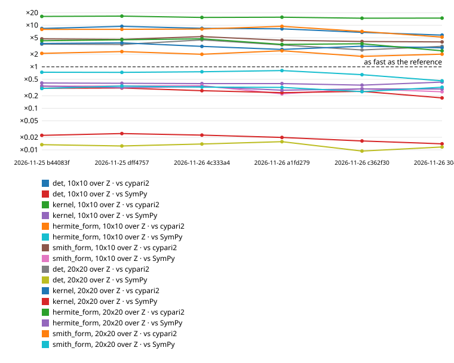

# ER2 performance history

Generated by `uv run python benchmarks/history.py` from the runs in `benchmarks/history/` (`make bench-record` adds one); do not edit by hand.

Each graph shows, run after run, how long ER2 takes compared with its reference (Python, `fractions`, SymPy or PARI through cypari2): below the dashed line ER2 is faster.  The goal is ER2 faster than Python and not much slower than PARI/GP.  Ratios are compared, not times, so runs on the same machine are comparable and the noise of a single run shows as small wiggles.

Runs: 2026-11-25 b44083f (main, baseline, before the improvements); 2026-11-25 dff4757 (main, rational + - * / fast path (c64f3f8)); 2026-11-26 4c333a4 (perf/plain-int, D22: plain int, exact / and ** (perf/plain-int)).

## Startup

| Benchmark | 2026-11-25 b44083f | 2026-11-26 4c333a4 | Change |
|---|---|---|---|
| `er2` startup, number theory only | ×6.32 | ×6.36 | ×1.01 |
| `er2` startup, with symbols (loads SymPy) | ×21.16 | ×22.01 | ×1.04 |

## Dispatch overhead (§2.1)

| Benchmark | 2026-11-25 b44083f | 2026-11-26 4c333a4 | Change |
|---|---|---|---|
| choose a backend: phi(n), an integer | ×0.06 | ×0.05 | ×0.94 |
| choose a backend: det, 10x10 over Z | ×0.01 | ×0.01 | ×0.98 |
| choose a backend: det, 10x10 with a symbol | ×0.00 | ×0.00 | ×1.03 |
| choose a backend: factor, a polynomial over Q | ×0.11 | ×0.12 | ×1.01 |

## Integer arithmetic (D2)

| Benchmark | 2026-11-25 b44083f | 2026-11-26 4c333a4 | Change |
|---|---|---|---|
| numeric loop, 20000 iterations (ER2 literals) | ×13.93 | ×1.06 | ×0.08 |
| `a + b` | ×8.25 | ×7.61 | ×0.92 |

## Exact rationals and large integers

| Benchmark | 2026-11-25 b44083f | 2026-11-26 4c333a4 | Change |
|---|---|---|---|
| `a + b`, rationals | ×2.80 | ×2.02 | ×0.72 |
| `a * b / (a - b)`, rationals | ×2.66 | ×1.54 | ×0.58 |
| `3^20000 * 3^20000`, large integers | ×1.01 | ×0.94 | ×0.93 |

## Number theory

| Benchmark | 2026-11-25 b44083f | 2026-11-26 4c333a4 | Change |
|---|---|---|---|
| phi(n), n ≈ 1.2e8 | ×0.06 | ×0.05 | ×0.81 |
| sigma(n), n ≈ 1.2e8 | ×0.06 | ×0.05 | ×0.90 |
| isprime(2^127 - 1), proven | ×1.02 | ×1.00 | ×0.98 |
| ispseudoprime (BPSW), Mersenne primes | ×0.32 | ×0.34 | ×1.06 |
| factor(n), n ≈ 1e18 semiprime | ×0.02 | ×0.02 | ×0.91 |

## Polynomial factorization

| Benchmark | 2026-11-25 b44083f | 2026-11-26 4c333a4 | Change |
|---|---|---|---|
| factor, degree 4 | ×0.47 | ×0.39 | ×0.82 |
| factor, degree 9 | ×0.33 | ×0.41 | ×1.24 |
| factor, degree 22 | ×0.16 | ×0.14 | ×0.91 |
| factor, degree 60 | ×0.04 | ×0.04 | ×1.09 |

## Polynomials over F_p (M5)

| Benchmark | 2026-11-25 b44083f | 2026-11-26 4c333a4 | Change |
|---|---|---|---|
| factor mod 7, degree 12 | ×0.37 | ×0.29 | ×0.79 |
| factor mod 7, degree 48 | ×0.16 | ×0.18 | ×1.12 |

## Linear algebra (M5)

| Benchmark | 2026-11-25 b44083f | 2026-11-26 4c333a4 | Change |
|---|---|---|---|
| det, 10x10 over Z | ×0.02 | ×0.02 | ×1.01 |
| kernel, 10x10 over Z | ×0.41 | ×0.39 | ×0.97 |
| hermite_form, 10x10 over Z | ×0.74 | ×0.76 | ×1.02 |
| smith_form, 10x10 over Z | ×0.34 | ×0.35 | ×1.04 |
| det, 20x20 over Z | ×0.01 | ×0.01 | ×1.04 |
| kernel, 20x20 over Z | ×0.30 | ×0.27 | ×0.87 |
| hermite_form, 20x20 over Z | ×0.34 | ×0.33 | ×0.97 |
| smith_form, 20x20 over Z | ×0.30 | ×0.32 | ×1.08 |

## Calculus and series

| Benchmark | 2026-11-25 b44083f | 2026-11-26 4c333a4 | Change |
|---|---|---|---|
| expand((x + k)^20) | ×1.00 | ×1.02 | ×1.02 |
| diff, 5th derivative of x^k e^x sin(x) | ×1.00 | ×1.03 | ×1.03 |
| integrate x^k e^x | ×1.00 | ×1.01 | ×1.01 |
| series of sin(x) e^(kx), order 10 | ×1.00 | ×0.80 | ×0.80 |
| limit of (sin(kx) - kx) / x^3 at 0 | ×1.01 | ×1.07 | ×1.06 |
